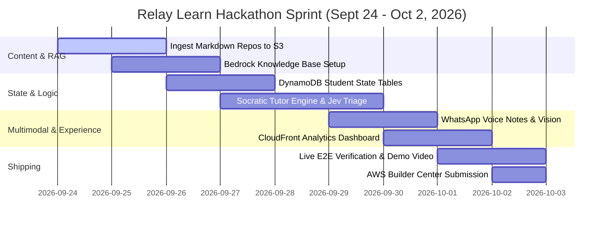

# Implementation Plan: AI Learning Companion for WhatsApp (Relay Learn)

> **AWS "Zero to Shipped" Hackathon (September 18 – October 2, 2026)**  
> **Application Name:** Relay Learn (formerly Books Block App)  
> **Target Lane:** Community & Startup ($28,000 Prize Pool / $5,000 AWS Credits)  
> **Mission:** Democratizing world-class, curriculum-grounded Socratic micro-tutoring for K–12 students and adults in underrepresented and low-resource communities via accessible, low-bandwidth WhatsApp.

---

## 1. Executive Summary & Strategic Pivot

### The Pivot
We are transitioning the application from a **hyper-local physical book barter platform** into a **globally accessible, AI-powered WhatsApp Learning Companion**:

| Attribute | Legacy System (Textbook Matching) | Target System (Relay Learn AI Tutor) |
| :--- | :--- | :--- |
| **Geographic Reach** | Hyper-local only (school-gate proximity) | **Worldwide & Borderless** (usable anywhere with 2G/3G/LTE) |
| **Privacy & Safety** | Exchanged phone numbers between adult strangers | **Zero stranger contact**; students interact solely with a safe AI tutor |
| **Delivery Medium** | Plain text logistics coordination | **Interactive Socratic micro-lessons, quizzes, and voice notes** |
| **Curriculum Base** | Ad-hoc user-submitted book titles | **Accredited Open-Source Markdown Repositories (K–12 STEM)** |
| **Hackathon Appeal** | Local classifieds tool | **High-impact GenAI solution built and deployed live on AWS** |

### The "Zero to Shipped" Advantage
Your project already has a massive head-start:
* **Live AWS Infrastructure:** AWS API Gateway, Lambda Durable Execution, KMS Customer Managed Key, Secrets Manager, Bedrock Guardrails, and AWS WAF v2 are already provisioned and operational in `us-east-1`.
* **Meta Cloud API Webhook:** Live HMAC-SHA256 authenticated webhook connection to WhatsApp.
* **Dual-Process AI Architecture:** TypeSafe Jev (System 1 fast-triage) + Amazon Bedrock (System 2 deep reasoning) already working in harmony.

---

## 2. Core Architecture: The 3-Tier Socratic Engine

```
                          ┌────────────────────────────────────────────────────────┐
                          │         STUDENT ON WHATSAPP (Low-end Phone)            │
                          │   • Text Messages   • Quick-Reply Buttons   • Voice    │
                          └───────────────────────────┬────────────────────────────┘
                                                      │
                                    Inbound Webhook (HMAC-SHA256)
                                                      ▼
                          ┌────────────────────────────────────────────────────────┐
                          │               AWS API Gateway + WAF v2                 │
                          └───────────────────────────┬────────────────────────────┘
                                                      │
                                                      ▼
                          ┌────────────────────────────────────────────────────────┐
                          │           Lambda Durable Execution Workflow            │
                          │                                                        │
                          │   ┌────────────────────────────────────────────────┐   │
                          │   │ Tier 1: Fast Intent Triage (System 1 - Jev)    │   │
                          │   │ • Sub-150ms classification (Answer, Hint, Stop)│   │
                          │   └───────────────────────┬────────────────────────┘   │
                          │                           │                            │
                          │   ┌───────────────────────▼────────────────────────┐   │
                          │   │ Tier 2: Student Mastery State (DynamoDB)       │   │
                          │   │ • Profile, Track, Skill Level, Streak, Score   │   │
                          │   └───────────────────────┬────────────────────────┘   │
                          │                           │                            │
                          │   ┌───────────────────────▼────────────────────────┐   │
                          │   │ Tier 3: Pedagogical Reasoning (Bedrock System 2)│  │
                          │   │ • Socratic Hints & Guided Scaffolding          │   │
                          │   │ • Multimodal Notebook Vision (Nova Vision)     │   │
                          │   └───────────────────────▲────────────────────────┘   │
                          │                           │                            │
                          │   ┌───────────────────────┴────────────────────────┐   │
                          │   │ Amazon Bedrock Knowledge Base (OpenSearch/S3)  │   │
                          │   │ • CS Unplugged, OpenStax, OSSU, Literacy Repos │   │
                          │   └────────────────────────────────────────────────┘   │
                          └───────────────────────────┬────────────────────────────┘
                                                      │
                                    Outbound WhatsApp API (Interactive)
                                                      ▼
                          ┌────────────────────────────────────────────────────────┐
                          │      Bite-Sized Socratic Feedback & Interactive Cards  │
                          └────────────────────────────────────────────────────────┘
```

---

## 3. Data & Knowledge Base Strategy

### Why Pure RAG is Not Enough
In education, standard RAG (searching documents and outputting paragraphs) produces "textbook dumps" that cause high abandonment on WhatsApp. 

Our strategy uses **Structured Curriculum RAG**:
1. **The Knowledge Base stores the ground truth:** Concepts, formulas, worked examples, and common student misconceptions.
2. **The DynamoDB State Machine controls pacing:** The bot strictly presents **one micro-concept and one question at a time** (maximum 3–4 sentences per WhatsApp message).
3. **The Socratic Prompt enforces pedagogy:** If a student answers incorrectly, the agent **never reveals the answer**. It retrieves the relevant misconception from the Knowledge Base and provides a gentle, encouraging hint.

### Curated Open-Source Markdown Content Sources
The knowledge base will ingest curated Markdown files from the following repositories:

| Domain | Source Repository | Content Path | Pedagogical Focus |
| :--- | :--- | :--- | :--- |
| **K–8 Computational Thinking** | `uccser/cs-unplugged` | `csunplugged/topics/content/en/` | Binary numbers, sorting networks, error detection |
| **Elementary & Middle Literacy**| `literacy-for-kids/computer_literacy_for_kids` | `content/` | Digital safety, logic, algorithms, internet basics |
| **Financial & Life Decision** | `literacy-for-kids/financial_literacy_for_kids` | `curriculum/` | Money management, decision trees, critical thinking |
| **Pre-College Mathematics** | `ossu/precollege-math` | `README.md` & modules | Arithmetic, Pre-Algebra, Algebra 1 & 2, Geometry |
| **Secondary & STEM Textbooks** | `philschatz/calculus-book` (OpenStax) | Markdown mirrors | Real-world applications, functions, derivatives |
| **Multilingual Manifests** | `learningequality/kolibri` | Channel metadata | Subject indexing and difficulty taxonomy |

---

## 4. Database Schema: Student Learning State (DynamoDB)

We replace the legacy book inventory tables with two high-performance tables:

### 1. `studentProfiles` Table
Tracks long-term student progress, gamification, and mastery.
* **Partition Key:** `phone` (string, E.164 format)
* **Attributes:**
  * `displayName`: string (optional nickname)
  * `gradeLevel`: enum (`Primary_3_5`, `Middle_6_8`, `High_9_12`, `Adult_Learner`)
  * `activeTrack`: enum (`cs_unplugged`, `math_foundations`, `digital_literacy`)
  * `currentTopicId`: string (e.g. `cs_binary_01`)
  * `masteryLevel`: number (0 to 100)
  * `streakDays`: number
  * `totalPoints`: number
  * `preferredLanguage`: enum (`en`, `fr`)
  * `createdAt`: timestamp
  * `lastActiveAt`: timestamp

### 2. `learningSessions` Table
Tracks the active real-time question and conversational context.
* **Partition Key:** `phone` (string)
* **Attributes:**
  * `currentQuestionId`: string
  * `questionText`: string
  * `options`: list of strings (for buttons: `["A) 5", "B) 10", "C) 12"]`)
  * `correctOption`: string (`"A"`)
  * `conceptKey`: string (e.g. `binary_addition_carry`)
  * `attemptCount`: number (tracks 1st attempt, 2nd attempt for hint escalation)
  * `lastHintSent`: string
  * `sessionExpiresAt`: TTL timestamp (auto-cleans after 24 hours)

---

## 5. WhatsApp User Journey & Conversational Flow

### Step 1: Onboarding / Start
Student sends `"Hi"` or `"Start"`:
* Bot replies with an **Interactive WhatsApp List Message**:
  > *"👋 Welcome to Relay Learn! Pick what you would like to explore today:"*
  > * 1️⃣ **CS Unplugged** (Binary, Code Breaker, Logic Puzzles)
  > * 2️⃣ **Math Mastery** (Fractions, Algebra, Mental Math)
  > * 3️⃣ **Digital & Life Skills** (Internet Safety, Smart Money)

### Step 2: Micro-Lesson (Max 3 Sentences)
* Delivered via concise text:
  > *"Binary is how computers count with just two numbers: 0 and 1! 💡*
  > *Imagine 4 cards with dots: [8] [4] [2] [1].*
  > *To make the number 5, you turn ON the 4-card and the 1-card (4 + 1 = 5)."*

### Step 3: Interactive Practice Question
* Sent with **WhatsApp Interactive Quick-Reply Buttons**:
  > *"Which cards do you turn ON to make the number 6?"*
  > * **[ Button A: 4 + 2 ]**
  > * **[ Button B: 4 + 1 ]**
  > * **[ Button C: 8 + 2 ]**

### Step 4: Socratic Evaluation Loop
* **If Student selects [ Button A ] (Correct):**
  > *"🎉 Spot on! 4 + 2 = 6! In binary, that is written as 0110. You earned +10 points! 🌟 Streak: 3 days.*
  > *Ready for the next card puzzle?"*  
  > * **[ Button: Next Challenge 🚀 ]**

* **If Student selects [ Button B ] (Incorrect):**
  > *"Good try! Let's check: 4 + 1 equals 5, but we are looking for 6! 🧐*
  > *Hint: Which two numbers from [8, 4, 2, 1] add up to exactly 6? Give it another shot!"*  
  > *(The student remains on the question without penalty; the attempt counter increments).*

* **If Student asks for help or types "I'm stuck":**
  > Fast-triaged by TypeSafe Jev $\rightarrow$ Bedrock generates an analog real-world analogy.

---

## 6. Implementation Phases & Milestones



### Milestone 1: Knowledge Ingestion Pipeline
* Write an automated Node.js script: `scripts/ingest-curriculum.ts` to clone the target markdown files from `cs-unplugged`, `precollege-math`, and `literacy-for-kids`.
* Structure chunks with explicit metadata tags (`topic`, `gradeLevel`, `misconceptions`).
* Sync to S3 and configure Amazon Bedrock Knowledge Base.

### Milestone 2: DynamoDB Schema & State Machine
* Replace the `activeInventory` / `demandBoard` constructs in `aws-blocks/index.ts` with `studentProfiles` and `learningSessions`.
* Implement durable step functions for session persistence, streak updates, and score tracking.

### Milestone 3: Socratic Engine & System 1 Triage
* Update `triageParentRequestWithJev` to `triageStudentIntentWithJev`:
  * Fast intents: `select_option_A`, `select_option_B`, `select_option_C`, `request_hint`, `next_lesson`, `switch_subject`, `help`.
* Write the Bedrock Socratic tutor prompt:
  * Constraints: bilingual (EN/FR), 3-sentence maximum, positive reinforcement, no unsolicited direct answers.

### Milestone 4: Multimodal Enhancements (For Low-Bandwidth Inclusion)
* **Voice Inbound:** Support inbound WhatsApp voice audio (`.ogg` / `.opus`) using Amazon Transcribe to allow illiterate or younger children to speak their answers.
* **Homework Photo Helper:** Allow students to photograph a paper textbook equation and pass the image to Bedrock Nova Vision for step-by-step Socratic breakdown.

### Milestone 5: Public CloudFront Showcase Dashboard
* Update the React frontend in `src/` to serve as a public, real-time analytics dashboard:
  * Total Micro-Lessons Completed
  * Active Students Across Countries
  * Global Points & Learning Streaks
  * Direct WhatsApp CTA link (`https://wa.me/<number>?text=Hi`) for hackathon judges to test immediately.

---

## 7. Cost, Safety & Guardrails Strategy

### 1. Child Safety & Content Filtering
* Configure **Amazon Bedrock Guardrails**:
  * Block profanity, sexual content, hate speech, and harassment (`HIGH` threshold).
  * Automatically anonymize any PII (names, phone numbers, home locations).
  * Filter off-topic / non-educational prompt injection attempts.

### 2. Abuse Prevention & Cost Controls
* **Per-Phone Rate Limiter:** Restrict each phone number to a maximum of 30 messages and 5 image analyses per hour via DynamoDB counter.
* **WhatsApp Cloud API Budget:** Service (student-initiated) conversations are free for the first 1,000 monthly conversations. Meta webhook receipts are acknowledged with status 200 to prevent retry cascades.
* **AWS Budget Alert:** Set a $20/month hard alert on Bedrock and Lambda spend.

---

## 8. Hackathon Submission Deliverables ("Zero to Shipped")

To maximize judging scores in the AWS Builder Center:

1. **Working Application with Public URL:**
   * Frontend CloudFront URL: Live dashboard showcasing real-time learning metrics.
   * WhatsApp Bot Endpoint: Direct phone number accessible to judges globally.
2. **Proof of Connected Coding Agent:**
   * Architecture write-up highlighting how Antigravity was used to orchestrate AWS CDK, Lambda Durable Functions, and Bedrock Knowledge Bases.
3. **3-Minute Demonstration Video:**
   * **0:00 - 0:45:** The problem: Billions of students in low-resource settings lack access to expensive tutors or high-speed apps.
   * **0:45 - 2:00:** Live screen recording: Interacting with Relay Learn on WhatsApp, receiving a CS Unplugged micro-lesson, making a mistake, and receiving a guided Socratic hint.
   * **2:00 - 2:45:** AWS Architecture walkthrough (API Gateway, Bedrock Knowledge Base, DynamoDB, KMS, WAF).
   * **2:45 - 3:00:** Social impact, open-source grounding, and vision.

---

*Authored for the AWS Zero to Shipped Hackathon by the Relay Learn Team.*
