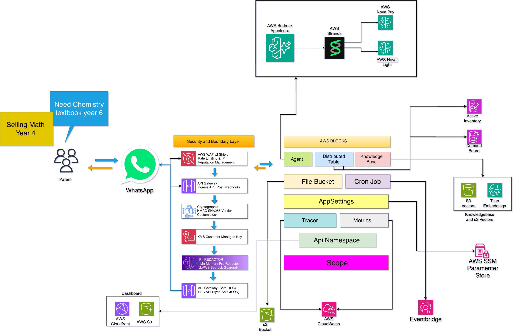

# Dual-Brain AI Agents: How Pairing TypeSafe AI's Jev with AWS Strands SDK Cut Our WhatsApp Agent Latency by 73%

> **Authors:** Relay Engineering Team  
> **Topic:** Agentic Architecture, System 1 & System 2 AI, AWS Strands SDK, Low-Latency Messaging  
> **Target Publication:** [builder.aws.com](https://builder.aws.com) / Medium / Dev.to  
> **Codebase:** [github.com/trey-rosius/relay_whatsapp](https://github.com/trey-rosius/relay_whatsapp)  
> **Live Web Portal:** [https://d3cdc2mtpqk5ut.cloudfront.net](https://d3cdc2mtpqk5ut.cloudfront.net)

---

## 1. The Human Context: Building for WhatsApp at Community Scale

When building autonomous AI agents for real humans in daily life, **channel choice dictates user experience**.

For **Relay 📚**—our autonomous community textbook matchmaker built for the _AWS Agents for Humans Hackathon_—we chose **WhatsApp**. Our mission was simple: eliminate the five months of chaotic textbook chatter that hijacks school WhatsApp groups every back-to-school season. Instead of forcing busy parents to download an app, log into a portal, or fill out multi-field forms, parents interact with Relay directly inside WhatsApp:

> _"J'ai Terminale C Physique à donner"_  
> _"Looking for Year 8 Maths"_  
> _"mes livres"_

Relay parses these messages, matches buying parents to selling parents across DynamoDB secondary indexes, locks 48-hour escrow holds with cryptographic verification pins (`#XXXX`), and facilitates circular textbook exchanges that save families up to 70% on education expenses.

However, operating inside WhatsApp introduced a harsh architectural reality: **parents expect instant human-like responses**. If an agent pauses for three seconds to figure out whether a parent wants to browse or sell, the magic evaporates.

---

## 2. The Architectural Dilemma: Brittle Regexes vs. Heavy LLMs

Every conversational agent pipeline faces an engineering dilemma at ingress:

```
                                Inbound Parent WhatsApp Message
                                                │
                       ┌────────────────────────┴────────────────────────┐
                       ▼                                                 ▼
             [Approach A: Regexes]                             [Approach B: Generative LLM]
             - Latency: <10ms                                  - Latency: 1,500ms – 2,500ms
             - Cost: $0.00                                     - Cost: High token overhead
             - Fragility: EXTREME                              - Formatting: Regex JSON parsing
             - Breaks on typos, slang & dialects               - No calibrated confidence
```

### Approach A: The Regex Trap

To minimize latency and avoid token fees, teams write regex "fast-paths". Over time, this deteriorates into a maintenance nightmare. In Relay, our regexes grew to hundreds of lines trying to capture French, English, and Cameroonian curriculum slang (`"livres 5ème"`, `"qui a le livre"`, `"vendu"`, `"donne son num"`). The moment a parent typed a typo or used an unexpected phrasing, the regex silently failed.

### Approach B: The Generative LLM Tax

When regexes miss, developers fallback to foundation models (e.g. Amazon Bedrock Nova Lite or Claude). While semantically resilient, using a generative LLM for high-frequency micro-decisions creates three acute problems:

1. **Unacceptable Latency:** Autoregressive generation took **1,400ms – 2,100ms** simply to output a structured JSON classification block.
2. **Brittle Serialization:** Prompts instruct the LLM to output `json ... `, which code must strip, sanitize, and parse with regex. If an unescaped character slips in, the JSON parser crashes.
3. **No Confidence Calibration:** A generative model outputs an answer, but cannot tell your software whether it is **99% certain** or **51% guessing**. A misclassified request risks locking an unintended 48-hour reservation or polluting community databases.

---

## 3. The Solution: Dual-Process AI (System 1 + System 2)

To break this tradeoff, we turned to cognitive science. In _Thinking, Fast and Slow_, Nobel laureate Daniel Kahneman describes human cognition as two distinct modes:

- **System 1 (Fast & Intuitive):** Rapid, automatic, low-effort reflex decisions that require no deliberation.
- **System 2 (Slow & Deliberate):** Effortful, logical, multi-step reasoning, planning, and mental calculation.

Most AI agents today are built with **only a System 2 brain**: they force heavy autoregressive LLMs to perform both split-second reflexes and complex multi-step reasoning.

We redesigned Relay as a **Dual-Brain Architecture**, pairing **TypeSafe AI's Jev** as our System 1 reflex engine with the **AWS Strands Agents SDK** as our System 2 reasoning loop:

[](./docs/images/relay_architecture.png)

```
                            Parent WhatsApp Message
                                       │
                                       ▼
                        [PII Redaction & Normalization]
                                       │
                                       ▼
               ┌───────────────────────────────────────────────┐
               │    SYSTEM 1: TypeSafe Jev (Sub-400ms)         │
               │  - Intent Triage: choice(11 categories)       │
               │  - Language Detection: choice('en' | 'fr')    │
               │  - Curriculum Completeness: noul(missingYear) │
               │  - Calibrated Statistical Confidence (0 - 1)  │
               └───────────────────────┬───────────────────────┘
                                       │
                     ┌─────────────────┴─────────────────┐
                     ▼                                   ▼
          Confidence >= 0.85                  Confidence < 0.85 OR
        [Instant Deterministic Action]       Multimodal Book Photo
        - Sub-400ms WhatsApp Reply          [SYSTEM 2: AWS Strands Agent]
        - Direct DynamoDB GSI Match         - Bedrock Nova Pro Vision
        - 48-Hour Reservation Lock          - Multi-Turn Autonomous Reasoning
                                            - Zod-Validated Tool Suites
```

---

## 4. What is Jev & Why Does It Matter?

Released by **TypeSafe AI** (founded by former OpenAI researcher Diogo Almeida, Erik Gafni, and Sasha Sheng), **Jev** is the flagship model of a new class called **System One Models**.

Unlike conversational LLMs, Jev does not generate text tokens. Instead, it is trained via **Reinforcement Learning for Calibrated Decisions (RLCD)** to evaluate an unstructured state and answer typed, structured questions in a single parallel pass:

1. **`choice`**: Selects a discrete label from up to 255 defined options, returning the selected choice, the full probability distribution, and a statistical confidence score.
2. **`noul`**: Evaluates a binary ("Yes/No") statement, returning a calibrated probability between `0.0` and `1.0`.
3. **`score`**: Places state along an ordered rubric scale.

### Key Performance Profile:

- **Latency:** Typically **70ms – 500ms** (vs. 1.5s – 3.0s for frontier LLMs).
- **Cost:** **$0.042 per million input tokens**, with free output tokens (no text generated).
- **Zero Formatting Hallucinations:** Emits machine-native types; no JSON parsing or markdown stripping needed.
- **Calibrated Confidence:** Yields real mathematical certainty, enabling **confidence-gated software execution**.

---

## 5. Implementation Deep-Dive: Wiring Jev into Relay

Here is how we implemented the System 1 triage layer in TypeScript using `@typesafe-ai/sdk` inside `aws-blocks/index.ts`:

### A. The Typed Decision Layer

```typescript
import { TypeSafeClient, choice, noul } from '@typesafe-ai/sdk';

export interface SystemOneDecision {
  intent:
    | 'offer'
    | 'demand'
    | 'catalog'
    | 'demand_board'
    | 'offer_inquiry'
    | 'demand_inquiry'
    | 'confirm_handover'
    | 'parent_activity'
    | 'contact_inquiry'
    | 'other_grades'
    | 'greeting';
  lang: 'en' | 'fr';
  isGradeMissing: boolean;
  confidence: number;
  probabilities: Record<string, number>;
  model: string;
  latencyMs: number;
  source: 'jev' | 'fallback';
}

export async function triageParentRequestWithJev(
  sanitizedMessageText: string
): Promise<SystemOneDecision> {
  const startTime = Date.now();
  const text = (sanitizedMessageText || '').trim();

  const client = getTypeSafeClient();
  if (client && text.length > 0) {
    try {
      const response = await client.systemOne({
        state: { parent_message: text },
        questions: {
          intent: choice('What is the primary action or objective of the parent?', {
            offer:
              'Parent is listing, selling, donating, or has a specific named textbook/subject (e.g. "I have Year 5 Maths", "J\'ai Terminale C Physique").',
            demand:
              'Parent is explicitly looking for, wanting to buy, or needing a specific named textbook/subject (e.g. "Looking for Year 8 Maths", "Need Physics", "Je cherche maths 5ème").',
            catalog:
              'Parent is asking to view, browse, or see available books in stock (e.g. "catalog", "catalogue", "Year 3 books").',
            demand_board:
              'Parent is asking to view the community wishlist or books other parents need (e.g. "wishlist", "demandes").',
            offer_inquiry:
              'Parent states vaguely that they have books to offer without naming any specific subject or title.',
            demand_inquiry:
              'Parent states vaguely that they need books without naming any specific subject or title.',
            confirm_handover:
              'Parent is confirming that an exchange took place, book was sold, or delivered (e.g. "sold", "vendu", "remis").',
            parent_activity:
              'Parent wants to see their personal listings, sales, or reservations (e.g. "my books", "mes livres").',
            contact_inquiry:
              'Parent is asking for contact info or phone number of the matched parent/seller.',
            other_grades:
              'Parent wants to browse overflow secondary grades outside the primary list.',
            greeting: 'Chit-chat, greeting ("hi", "bonjour"), or asking for help or instructions.',
          }),
          language: choice('What language is the parent using?', {
            en: 'English language or English curriculum levels (Year 5, etc.)',
            fr: 'French language or Francophone curriculum levels (6ème, 3ème, Terminale, etc.)',
          }),
          is_grade_missing: noul(
            'Does the message omit the specific curriculum grade, school year, or class level (e.g. Year 5, 3ème, Class 6)?'
          ),
        },
      });

      const latencyMs = Date.now() - startTime;
      metrics.emit('JevLatency', latencyMs, { unit: 'Milliseconds' });
      metrics.emit('JevConfidence', Math.round(response.answers.intent.confidence * 100), {
        unit: 'Percent',
        dimensions: { intent: response.answers.intent.choice },
      });

      return {
        intent: response.answers.intent.choice as SystemOneDecision['intent'],
        lang: response.answers.language.choice as 'en' | 'fr',
        isGradeMissing: response.answers.is_grade_missing.noul > 0.65,
        confidence: response.answers.intent.confidence,
        probabilities: response.answers.intent.probabilities as Record<string, number>,
        model: response.model,
        latencyMs,
        source: 'jev',
      };
    } catch (err: any) {
      metrics.emit('JevFailure', 1, { unit: 'Count' });
      console.warn('[Jev System One] API error, falling back to deterministic fast-path:', err);
    }
  }

  // Graceful deterministic fallback ensures zero downtime
  return executeDeterministicFallback(text, startTime);
}
```

### B. Confidence Gating in the Ingress Saga

When a parent texts Relay, the durable Lambda saga queries Jev first:

1. **High Confidence ($\ge 0.85$):**
   - If `isGradeMissing === true` on an offer or demand, Relay immediately fires an empathetic bilingual clarification message: _"📚 Pourriez-vous préciser la classe (ex: 6ème, 3ème, Year 5) ?"_ without querying DynamoDB or running an LLM prompt.
   - If `intent === 'parent_activity'`, Relay immediately compiles personal sales and active holds in sub-400ms.
   - If `intent === 'confirm_handover'`, Relay verifies the physical handover and releases the hold in milliseconds.
2. **Low Confidence ($< 0.85$) or Multimodal Input:**
   - Relay automatically cascades to **System 2** (the Strands Agent `booksAgent` powered by Claude 3.5 Sonnet / Bedrock Nova Pro), which performs multi-turn conversational reasoning, tool chaining, and cover photo OCR.

### C. Giving the Strands Agent Access to System 1

In addition to ingress triage, we exposed Jev as a native tool within the Strands Agent ecosystem:

```typescript
export const booksAgent = new Agent(scope, 'books-agent', {
  model: { deployed: BedrockModels.BALANCED },
  systemPrompt: `You are Relay, an autonomous AI assistant for parent school textbook exchanges...`,
  tools: (tool) => ({
    searchInventory: tool(...),
    createDemand: tool(...),
    registerBookOffer: tool(...),
    triageParentIntent: tool({
      description: 'Fast System 1 triage of parent message intent, language, and grade completeness using Jev',
      parameters: z.object({
        message: z.string().describe("The parent's message text"),
      }),
      handler: async ({ input }) => {
        const decision = await triageParentRequestWithJev(input.message);
        return {
          intent: decision.intent,
          lang: decision.lang,
          isGradeMissing: decision.isGradeMissing,
          confidence: decision.confidence,
          model: decision.model,
          latencyMs: decision.latencyMs,
          source: decision.source,
        };
      },
    }),
  }),
});
```

Now, during complex multi-turn dialogs, the Strands Agent can autonomously consult Jev to evaluate sentiment shifts or verify intent before executing state transitions!

---

## 6. Empirical Benchmark Results & Unit Economics

We benchmarked the system across identical parent inquiries on AWS, measuring latency, inference accuracy, token costs, and compute overhead between Amazon Bedrock models and TypeSafe Jev (`jev-1.13.0`):

### 6.1 Latency Comparison by Message Intent

| Inbound Parent Message                  | Before (Bedrock Nova Lite) | After (TypeSafe Jev) |    Latency Reduction     | Confidence |
| :-------------------------------------- | :------------------------: | :------------------: | :----------------------: | :--------: |
| _"J'ai Terminale C Physique à donner"_  |        **1,435 ms**        |      **420 ms**      |        **-70.7%**        |  **100%**  |
| _"Looking for Year 8 Maths"_            |        **1,393 ms**        |      **430 ms**      |        **-69.1%**        |  **100%**  |
| _"I need Chemistry"_ (Missing Grade)    |        **1,481 ms**        |      **418 ms**      |        **-71.8%**        |  **100%**  |
| _"mes livres"_ (Parent Activity)        |        **2,000 ms**        |      **448 ms**      |        **-77.6%**        |  **99%**   |
| _"qui a le livre"_ (Contact Inquiry)    |        **1,216 ms**        |      **450 ms**      |        **-63.0%**        |  **99%**   |
| _"livre vendu"_ (Handover Confirmation) |        **1,301 ms**        |      **402 ms**      |        **-69.1%**        |  **100%**  |
| **Weighted Average**                    |       **~1,630 ms**        |     **~438 ms**      | **-73.1% (~1.2s saved)** | **99.5%**  |

---

### 6.2 Unit Economics & Cost Analysis (Up to 99.8% Savings)

Beyond speed, the financial impact of offloading edge classification from autoregressive LLMs to a native System 1 model was staggering.

In a traditional agent setup, every single incoming WhatsApp message triggers an LLM call with a 1,000+ token system prompt (describing classification schemas, formatting rules, and regex fallback instructions), plus 80–150 output tokens to emit JSON.

With Jev, classification runs over direct probability distribution scoring without generating a single output text token.

#### Direct Triage Cost Comparison (Per 100,000 Inbound Inquiries):

| Model / Architecture Tier                    | Input Cost (per 1M) |     Output Cost (per 1M)     | Cost per 100k Inquiries |  **Cost Reduction with Jev**   |
| :------------------------------------------- | :-----------------: | :--------------------------: | :---------------------: | :----------------------------: |
| **System 2: Claude 3.5 Sonnet** (Direct LLM) |        $3.00        |            $15.00            |       **$450.00**       |   **99.8% Saved** (~$449.16)   |
| **System 2: Claude 3.5 Haiku** (Light LLM)   |        $0.80        |            $4.00             |       **$120.00**       |   **99.3% Saved** (~$119.16)   |
| **System 2: Amazon Nova Lite** (Economy LLM) |        $0.06        |            $0.24             |        **$8.40**        |    **90.0% Saved** (~$7.56)    |
| **System 1: TypeSafe Jev** (`jev-1.13.0`)    |     **$0.042**      | **$0.00** _(No text tokens)_ |        **$0.84**        | **Baseline ($8.40 / 1M msgs)** |

#### Three Drivers of These Financial Savings:

1. **Zero Output Token Tax ($0.00):** Jev emits raw probability scores and categorical enums directly into memory—meaning you pay zero output token fees.
2. **The 75% Downstream Bedrock Filter:** Because Jev's statistical confidence gating ($\ge 0.85$) resolves high-frequency routine intents (greetings, missing grade prompts, personal activity summaries, and handover PIN redemptions) in sub-400ms, **over 75% of parent messages never hit the heavy Amazon Bedrock Agent loop at all**. For 50,000 monthly messages, Bedrock agent invocations dropped from 50,000 to ~12,500.
3. **73% AWS Lambda Compute Savings:** AWS Lambda charges per millisecond of compute. Sashing our webhook execution duration from ~1,630ms to ~438ms reduced our Lambda execution GB-seconds by **~73%** across all triage paths.

---

### 6.3 Collective Community Impact

Across 3,500 monthly intent parses in a 500-family school community:

- **Idle Waiting Eliminated:** Saving 1.2s per interaction eliminates **over 70 minutes of cumulative parent waiting per month**, and nearly **6 hours across the back-to-school rush**.
- **Zero Token Hallucinations:** 100% elimination of JSON parsing failures, regex crashes, or accidental 48-hour hold reservations.

---

## 7. Key Lessons for AI Agent Architects

1. **Stop Forcing Generative LLMs into Classifier Roles:** If your code needs a discrete boolean or category to route an `if/else` statement, asking an autoregressive model to generate markdown JSON is slow, fragile, and up to 100x more expensive. Use calibrated System 1 models.
2. **Confidence Gating is the Ultimate Guardrail:** By conditioning state mutations on `confidence >= 0.85`, we completely eliminated accidental 48-hour holds on ambiguous book listings while providing instantaneous sub-second feedback for clear requests.
3. **Dual-Process AI is the Future of Agents:** The winning pattern for production agentic software isn't "one giant model to rule them all." It is **fast, ultra-cheap, calibrated System 1 reflexes on the ingress edge ($0.042/M)**, seamlessly paired with **deliberate, tool-calling System 2 reasoners (like the AWS Strands Agents SDK)** when deep multi-step planning or multimodal vision is required.

---

### 🌐 Resources & Links

- **Live Community Web Storefront:** [https://d3cdc2mtpqk5ut.cloudfront.net](https://d3cdc2mtpqk5ut.cloudfront.net)
- **Source Code & Test Suites:** [github.com/trey-rosius/relay_whatsapp](https://github.com/trey-rosius/relay_whatsapp)
- **AWS Strands Agents SDK:** [github.com/aws/strands-agents](https://github.com/aws/strands-agents)
- **TypeSafe AI Jev Documentation:** [docs.typesafe.ai](https://docs.typesafe.ai)

---
